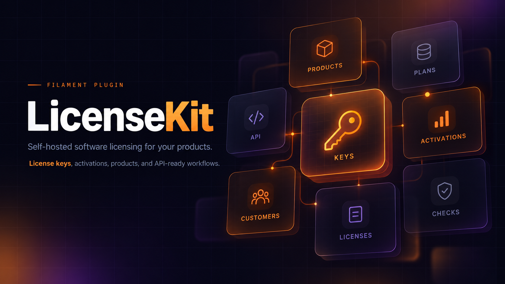

# 🛡️ LicenseKit

> **A Filament plugin for self-hosted software licensing and HWID node-locking.**

[](LICENSE)
[](https://www.php.net/)
[](https://laravel.com)
[](https://filamentphp.com)

**LicenseKit** is a Filament plugin and a self-hosted licensing engine for independent developers selling desktop applications, game enhancements, private clients, and automation tools.

Stop paying monthly SaaS fees to services that police your business or crash when other users get DDoS'd. Host your own licensing infrastructure on your own servers with zero middleman risk.

I have run licensing for private desktop software since 2019. This is the package I wish I had when I started.

> **Pre-release.** LicenseKit is not on Packagist yet. It will be published as a Composer package once it is ready. Until then, install it from this repository.

### 🚀 Why LicenseKit?

* **💳 100% Commerce Agnostic (Gateway Immunity)**: Run your own storefront, or sell keys through Shopify, Stripe, WooCommerce, or Telegram resellers. Use any of them at the same time. If a payment processor shuts down one store, your licensing database is untouched.
* **💻 Resilient HWID Node-Locking**: Supports both strict exact matching and multi-signal fuzzy matching. Legitimate GPU or SSD upgrades won't lock out paying customers.
* **⚡ Operational Downtime Compensation**: Planned game updates or unexpected server crashes? Pause client access and automatically credit lost subscription time in queued batches.
* **🤝 Built for Reseller Distribution**: Create license keys in batches, export clean `.txt` files in 1 click, and revoke unsold batches with one click if a reseller disputes payment.
* **🎨 Beautiful Filament Admin UI**: Turnkey dashboard, [Filament Shield](https://github.com/bezhanSalleh/filament-shield) ready. Shield is optional and not bundled. Let support staff inspect hardware diffs and reset devices without giving them access to create license keys or API tokens.
* **🔒 Host-Owned Security**: LicenseKit owns the entitlement math and hardware locks. You own customer authentication, desktop handshake protocols, and billing.

### 📊 Quick comparison

| Feature | KeyAuth (SaaS) | Keygen.sh | Basic packages | **LicenseKit** |
| :--- | :---: | :---: | :---: | :---: |
| **Self-Hosted / Sovereign** | ❌ | ❌ | ✅ | **✅ (100% Free MIT)** |
| **No Risk of Account Bans** | ❌ (ToS) | ❌ (ToS) | ✅ | **✅ (You own the DB)** |
| **Turnkey Admin Dashboard** | ⚠️ (Outdated) | ⚠️ (Basic) | ❌ | **✅ (Modern Filament)** |
| **HWID Fuzzy Matching** | ❌ (Exact only) | ⚠️ (Custom) | ❌ | **✅ Built-in interface** |
| **Downtime Time Compensation** | ❌ | ❌ | ❌ | **✅ One-click batch credit** |
| **Multi-Storefront Support** | ⚠️ (Clunky) | ✅ | ⚠️ | **✅ Native idempotency** |

### 🛠️ Architecture in 30 seconds

LicenseKit plugs into the Laravel app you already have.

1. **Your storefront, or a webhook** from Stripe or Shopify, creates license keys. The same order id returns the same keys. [Create license keys](docs/shops.md).
2. **Customer** claims the key on your site through `ClaimLicense::claim($user, $serial)`.
3. **Desktop client** logs in through your controller. `LicensedDevices::bind()` checks the license and locks the PC.

```php
use LicenseKit\Core\Actions\LicensedDevices;

public function login(Request $request, LicensedDevices $devices)
{
    $user = $request->user();

    $auth = $devices->bind($user, $product, $request->input('hwid'));

    return response()->json([
        'token' => $user->createToken('desktop-session')->plainTextToken,
        'valid_until' => $auth->access->validUntil,
    ]);
}
```

`$hwid` is an array. Heartbeats call `verify()`, which checks the saved PC and does not move the lock. [Connect your app](docs/client.md).

### ✅ Compatibility

| | |
| :--- | :--- |
| **PHP** | 8.3+ |
| **Laravel** | 12, 13 |
| **Filament** | 5.8.3+ |
| **Sanctum** | 4.3+ |
| **[Filament Shield](https://github.com/bezhanSalleh/filament-shield)** | 4.x, optional |
| **spatie/laravel-permission** | Selected by Composer for your PHP and Shield versions, optional |

LicenseKit checks ordinary Laravel policies. Install Shield in your app when you want roles. It is not a LicenseKit dependency. Custom actions such as reset HWID and create keys need the [Shield recipe](docs/installation.md#optional-filament-shield). A policy that says no is final.

### 📦 Installation

PHP 8.3+, Laravel 12 or 13, Filament 5.8.3+, and Sanctum 4.3+. Accounts and login stay in your app.

Not on Packagist yet. Install the pre-release from Git, then:

```sh
composer config repositories.licensekit vcs https://github.com/Krixx1337/filament-licensekit.git
composer require licensekit/licensekit:dev-main
php artisan licensekit:install --no-interaction
```

```php
use LicenseKit\LicenseKitPlugin;

return $panel->plugin(LicenseKitPlugin::make());
```

```sh
php artisan migrate
php artisan licensekit:check
```

Shield permissions, host user settings, and the rest of setup are in [installation](docs/installation.md). After that, [connect your app](docs/client.md) and [create license keys](docs/shops.md).
